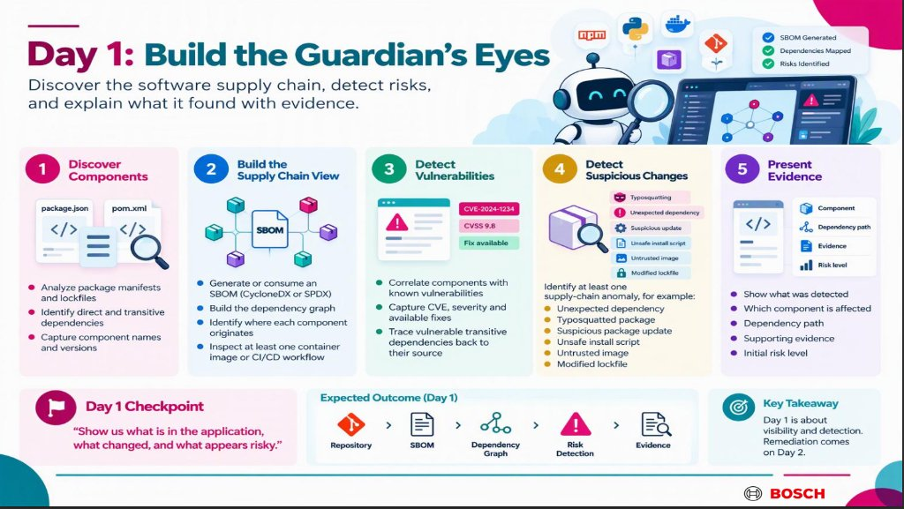

# Software Supply Chain Guardian

> **Day 1: Build the Guardian's Eyes**  
> *"Discover the software supply chain, detect risks, and explain what it found with evidence."*



---

## 🎯 Executive Summary & Day 1 Objectives

Modern applications are assembled from hundreds or thousands of open-source libraries, container base images, and CI/CD automation workflows. Attackers increasingly exploit this software supply chain through malicious packages, typosquatting, unauthorized lockfile modifications, unpinned dependencies, and known vulnerabilities (CVEs).

The **Software Supply Chain Guardian** is an enterprise-grade supply-chain security platform designed to automatically inspect any repository, map out its complete direct and transitive dependency graph, generate standardized Software Bills of Materials (SBOMs), detect known vulnerabilities and zero-CVE anomalies, and present human- and machine-verifiable evidence.

### Day 1 Checkpoint
> **"Show us what is in the application, what changed, and what appears risky."**  
> **Key Takeaway:** *Day 1 is strictly about visibility and detection. Remediation comes on Day 2.*

```
┌──────────────┐     ┌──────────────┐     ┌──────────────────┐     ┌────────────────┐     ┌──────────────┐
│  Repository  │ ──► │  CycloneDX   │ ──► │ Dependency Graph │ ──► │ Risk Detection │ ──► │   Evidence   │
│ Ingestion    │     │  1.6 SBOM    │     │ (DAG Analysis)   │     │ (Vulns & Bugs) │     │ Presentation │
└──────────────┘     └──────────────┘     └──────────────────┘     └────────────────┘     └──────────────┘
```

---

## 🏛️ The Five Core Pillars of Day 1

The system executes a five-stage detection and visibility pipeline corresponding directly to the Day 1 milestones:

```
+----------------------------------------------------------------------------------------------------+
| 1. Discover Components | 2. Supply Chain View | 3. Vulnerabilities | 4. Suspicious Changes | 5. Evidence   |
+----------------------------------------------------------------------------------------------------+
```

### 1. Discover Components
- **Deep Manifest & Lockfile Analysis:** Automatically detects and parses manifests and lockfiles across JavaScript/TypeScript (`package.json`, `package-lock.json`, `npm-shrinkwrap.json`), Python (`requirements.txt`, `poetry.lock`, `uv.lock`, `Pipfile.lock`), Java (`pom.xml`), and Go (`go.mod`, `go.sum`).
- **Direct vs. Transitive Resolution:** Unpacks the entire dependency hierarchy, identifying which packages are explicitly required by the developers and which are pulled in as indirect dependencies.
- **Accurate Metadata Capture:** Normalizes exact package names, declared version constraints, resolved versions, registries, integrity hashes (SHA-512/SHA-256), and development-only flags.

### 2. Build the Supply Chain View
- **Standardized SBOM Generation:** Synthesizes an industry-standard **CycloneDX 1.6** JSON bill of materials validated against official schemas.
- **Dependency Graph (DAG):** Constructs a directed acyclic graph capturing exact parent-to-child edges, package depths, and transitive chains.
- **Component Origin Tracking:** Pinpoints the source of every component (e.g., official npm registry, PyPI, Maven Central, Go proxy, Docker Hub).
- **Infrastructure & CI/CD Discovery:** Discovers and inspects container artifacts (Dockerfiles across multi-stage builds, Docker Compose files) and CI/CD automation (`.github/workflows/*.yml`).

### 3. Detect Vulnerabilities
- **Correlating Known Advisories:** Scans the generated CycloneDX SBOM using **OSV-Scanner** backed by the Google Open Source Vulnerabilities (OSV) database.
- **Severity & Fix Identification:** Extracts CVE IDs, GHSA advisories, CVSS v3/v4 base scores, CWE classifications, and the minimum safe fixed versions.
- **Root-Cause Analysis:** Traces vulnerable transitive dependencies back to the responsible direct root package. Distinguishes between:
  - *Direct vulnerability:* Upgrade the root manifest entry.
  - *Stale lockfile:* Every declared parent range already admits the fix; a simple lockfile refresh (`npm update` / lockfile re-lock) fixes it.
  - *Blocked by parent:* A parent package strictly constrains the child to an insecure version, requiring an override, patch, or parent update.
- **Grouped Remediation Hints:** Groups findings by the single action that resolves them (e.g., *"Upgrading direct dependency X fixes 5 vulnerable transitive packages"*).

### 4. Detect Suspicious Changes & Supply Chain Anomalies
Detects high-risk behaviors that bypass traditional CVE scanners:
- **Typosquatting Detection:** Uses Optimal String Alignment (OSA) distance against popular ecosystem packages, verifying weekly download volumes to flag deceptive package names (e.g., `cross-env-pkg` vs. `cross-env`).
- **Unsafe Lifecycle Install Scripts:** Flags packages running automated arbitrary code (`preinstall`, `install`, `postinstall`) during dependency resolution.
- **Suspicious Registries & Git Dependencies:** Detects dependencies pulled from non-standard registries, raw git URLs, or untrusted endpoints.
- **Missing Integrity Hashes & Unbounded Ranges:** Identifies lockfile bypasses, wildcard versions (`*`, `>=0.0.0`), and packages lacking cryptographic verification.
- **Unpinned Images & Actions:** Flags Docker containers using `:latest` or untagged base images, and GitHub Actions pinned to mutable branches rather than immutable commit SHAs.
- **Dangerous CI/CD Workflows:** Identifies `pull_request_target` triggers that execute untrusted code from external fork pull requests.
- **"What Changed" Baseline Comparison:** Diffing an updated scan against a baseline scan to immediately highlight unexpected additions, version downgrades, and **lockfile integrity tampering** (where a package hash changes despite the version remaining the same).

### 5. Present Evidence
- **Single Verified Finding List:** Consolidates CVEs and anomalies into an actionable finding registry.
- **Transparent Risk Scoring:** Calculates an **Initial Risk Level** (`Critical`, `High`, `Medium`, `Low`, `Info`) with transparent scoring factors:
  - Base CVSS score or anomaly weight
  - Runtime vs. Dev/Test dependency scope
  - Reachability (whether application code actually imports the package)
  - Real-world exploit likelihood via **FIRST EPSS**
  - Confirmed active exploitation via **CISA KEV** (Known Exploited Vulnerabilities catalog)
- **Detailed Audit Trail:** Every finding includes exact source file paths, line numbers, lockfile values, and dependency paths from root to leaf.
- **Graph Visualizer:** Highlights risky paths in red/orange with one-click filtering to isolate high-risk branches.

---

## 🛠️ Technologies Used: Why, How, and Where

| Technology | Where It Is Used | Why We Chose It | How It Operates |
|---|---|---|---|
| **Python 3.11+ / 3.12** | Core architecture (`guardian/`) | Robust standard library, native typing, dataclasses, asynchronous process controls, and rich security tooling ecosystem. | Implements the pipeline engine, parsing routines, heuristic detectors, graph transformations, and CLI/API services. |
| **NetworkX (`networkx>=3.2`)** | `guardian/graph.py` | High-performance graph algorithms, directed graph (DAG) primitives, cycle detection, and traversal utilities. | Builds a `nx.DiGraph` representing the repository supply chain. Computes shortest paths from root to transitive dependencies, determines hierarchy depths, detects cyclic references, and serializes graph nodes and edges. |
| **CycloneDX 1.6 Specification** | `guardian/cyclonedx.py`, `guardian/normalize.py` | Globally recognized OWASP standard for enterprise Software Bills of Materials (SBOMs), compatible with security scanners and compliance frameworks. | Generates and validates `bom.cdx.json` schemas with component classifications, Package URLs (purls), hashes, licenses, properties, and explicit dependency link arrays. |
| **cdxgen (`@cdxgen/cdxgen`) & Docker** | `guardian/cdxgen_runner.py` | Universal multi-language SBOM engine covering 30+ package ecosystems (.NET, Gradle, Rust Cargo, Ruby Bundler, PHP Composer, Yarn, Pnpm) without writing custom compilers for every ecosystem. | Invoked locally or within an isolated Docker container (`ghcr.io/cdxgen/cdxgen:v13.8`) with the target repository mounted read-only and `--no-install-deps` enabled for safe sandboxing. |
| **OSV-Scanner (Google OSV)** | `guardian/vulns.py` | Google's authoritative vulnerability scanner evaluating real package versions against the Open Source Vulnerabilities database with commit-level accuracy. | Invoked via CLI against `bom.cdx.json` (`osv-scanner scan source -L bom.cdx.json --format json`). Guardian correlates advisories back to graph nodes to perform automated root-cause analysis. |
| **Flask (`flask>=3.0`) & Jinja2** | `guardian/web.py`, `guardian/templates/` | Lightweight, dependency-free web microframework providing local dashboards without complex frontend build toolchains. | Hosts the local dashboard at `127.0.0.1:5000`, queues scan jobs in background worker threads, streams real-time logs, serves REST APIs, and allows instant file downloads. |
| **Vanilla JavaScript (ES6+), SVG & CSS3** | `guardian/static/app.js`, `guardian/static/style.css` | 100% self-contained, air-gapped safe, zero external CDN dependencies, fast rendering, and zero frontend supply-chain risk. | Implements interactive DAG visualization, search and filter tables, real-time log streaming, finding side-drawers, and baseline comparison views. |
| **PyYAML (`pyyaml>=6.0`)** | `guardian/artifacts.py` | Standard, battle-tested YAML parser for Python. | Safely reads GitHub Actions workflow definitions and Docker Compose manifests to extract image references, build contexts, triggers, and permissions. |
| **Package URL (PURL) Specification** | `guardian/purl.py` | Universal package identification standard (`pkg:npm/...`, `pkg:pypi/...`, `pkg:maven/...`, `pkg:golang/...`, `pkg:docker/...`). | Canonicalizes package identifiers across disparate package managers so that vulnerability lookups, graph joins, and anomaly heuristics operate consistently. |
| **FIRST EPSS API** | `guardian/evidence.py` | Empirical threat intelligence modeling the real-world probability (0.0 to 1.0) that a vulnerability will be actively exploited in the next 30 days. | Queries `api.first.org/data/v1/epss` for detected CVEs when online, elevating findings with elevated real-world exploit probability. |
| **CISA KEV Catalog** | `guardian/evidence.py` | U.S. Cybersecurity and Infrastructure Security Agency's Known Exploited Vulnerabilities catalog. | Downloads the official CISA KEV JSON catalog and checks whether any detected CVE is actively exploited in the wild, escalating its risk level immediately to Critical. |
| **Pytest (`pytest>=8.0`)** | `tests/test_guardian.py` | Python automated test runner and assertion framework. | Automates testing of manifest parsers, DAG traversals, edge-case resolution, and vulnerability correlation against real fixture repositories. |

---

## 🏗️ Architecture & Pipeline Flow

```
                                  +-----------------------+
                                  | GitHub URL / Local Dir|
                                  +-----------------------+
                                              |
                                              v
                              +-------------------------------+
                              |    Shallow Clone & Ingestion  |
                              |  (Safe flags, no credentials) |
                              +-------------------------------+
                                              |
                                              v
                              +-------------------------------+
                              |      Component Detection      |
                              |   (Manifests, Locks, Docker,  |
                              |      Workflows, Compose)      |
                              +-------------------------------+
                                              |
                       +----------------------+----------------------+
                       |                                             |
                       v                                             v
        +-----------------------------+               +-----------------------------+
        |     cdxgen Polyglot Engine  |               |    Built-in Exact Parsers   |
        |   (Docker sandbox fallback) |               |  (npm, PyPI, Maven, Go, CI) |
        +-----------------------------+               +-----------------------------+
                       \                                             /
                        \                                           /
                         v                                         v
                      +-----------------------------------------------+
                      |        CycloneDX 1.6 SBOM Normalization       |
                      |            (Canonical PURL Index)             |
                      +-----------------------------------------------+
                                              |
                                              v
                              +-------------------------------+
                              |     NetworkX Graph Builder    |
                              |  (DAG, Paths, Depths, Edges)  |
                              +-------------------------------+
                                              |
                       +----------------------+----------------------+
                       |                                             |
                       v                                             v
        +-----------------------------+               +-----------------------------+
        |    OSV Vulnerability Scan   |               |   Anomaly & Heuristic Engine|
        |  (CVE, CVSS, Root-Cause)    |               | (Typosquat, Scripts, Images)|
        +-----------------------------+               +-----------------------------+
                       \                                             /
                        \                                           /
                         v                                         v
                      +-----------------------------------------------+
                      |     Evidence Engine & Risk Scoring            |
                      |  (Reachability, EPSS, CISA KEV, Scope)        |
                      +-----------------------------------------------+
                                              |
                                              v
                              +-------------------------------+
                              |        Delivery & Output      |
                              |  - Local Web UI (Port 5000)   |
                              |  - CLI JSON / Tabular Output  |
                              |  - Output Directory Artifacts |
                              +-------------------------------+
```

---

## 🔒 Security & Sandboxing Guarantees

Running untrusted open-source code during analysis can compromise the analyst's machine. Guardian enforces strict safety boundaries:

1. **Never Executes Package Scripts:** npm lockfile generation strictly enforces `--ignore-scripts`.
2. **Never Executes Repo-Supplied Wrappers:** Shell wrappers such as `./mvnw` or `./gradlew` committed in target repositories are ignored. Only system binaries or containerized tools run.
3. **Container Isolation:** When invoking `cdxgen`, the target repository is mounted **read-only** (`:ro`), preventing malicious build steps from altering source files.
4. **Local Network Binding:** The web dashboard binds strictly to `127.0.0.1`.
5. **Zero-CDN Frontend:** The web UI does not download third-party JavaScript or CSS from CDNs, guaranteeing air-gapped safety and preventing XSS/supply-chain tampering in the browser.

---

## 🚀 Getting Started

### 1. Installation

Clone this repository and install Python dependencies:

```bash
git clone https://github.com/ArnavPal6805/supply-chain-guardian.git
cd supply-chain-guardian

python3 -m venv .venv
source .venv/bin/activate
pip install -r requirements.txt
```

### 2. Optional Recommended Tools

Each optional utility unlocks additional capabilities:

| Utility | Installation | Capability Unlocked |
|---|---|---|
| **OSV-Scanner** | [GitHub Releases](https://github.com/google/osv-scanner/releases) (place in `$PATH`) | Scans generated SBOM for known vulnerabilities (Pillar 3). |
| **Docker** | System package / Docker Desktop | Polyglot cdxgen support for Gradle, Rust, .NET, Ruby, PHP. |
| **Node.js / npm** | System package (`npm`) | Generates exact lockfiles for npm projects that don't commit one. |
| **Maven (`mvn`)** | System package (`mvn`) | Computes exact transitive trees for Maven projects via `dependency:tree`. |
| **Go (`go`)** | System package (`go`) | Computes exact parent relationships for `// indirect` Go modules. |

---

## 💻 Usage

### Web Interface

Launch the interactive dashboard:

```bash
python -m guardian.web
```

Open `http://127.0.0.1:5000` in your browser. Enter any public GitHub repository URL (e.g., `https://github.com/juice-shop/juice-shop` or `https://github.com/GoogleCloudPlatform/microservices-demo`) and click **Analyze Repository**.

### Command Line Interface (Headless)

Run a complete headless scan directly from the command line:

```bash
# Analyze a remote repository
python -m guardian.cli analyze https://github.com/juice-shop/juice-shop -o output/juice-shop

# Analyze a local workspace
python -m guardian.cli analyze /path/to/my-project -o output/my-project
```

### Demonstrating "What Changed" (Baseline Comparison)

1. Perform a baseline scan of a repository:
   ```bash
   python -m guardian.cli analyze https://github.com/your-org/sample-repo -o output/scan-v1
   ```
2. Commit a modification to your fork (e.g., downgrade a dependency, add a new library, or tamper with an `integrity` hash in `package-lock.json`).
3. Run the secondary scan referencing the baseline:
   ```bash
   python -m guardian.cli analyze https://github.com/your-org/sample-repo --baseline output/scan-v1 -o output/scan-v2
   ```
4. The Guardian engine will immediately flag:
   - Added or removed dependencies.
   - Version downgrades.
   - Changed download sources or registry origins.
   - **Altered integrity hashes** for existing packages (detecting supply-chain tampering).

---

## 📦 Generated Output Artifacts

Every completed analysis produces machine-readable artifacts in its output directory (`output/jobs/<job-id>/` or specified `-o` directory):

- `bom.cdx.json` — Standardized **CycloneDX 1.6** SBOM. Ready to ingest into tools like Grype, Dependency-Track, or OSV-Scanner.
- `result.json` — Complete normalized inventory (components, purls, direct/transitive flags, depths, origin registries, integrity hashes, and completeness notes).
- `graph.json` — Directed dependency graph with node metadata and directed parent-child edges for external graph databases or D3/Cytoscape renderers.
- `findings.json` — Comprehensive list of detected vulnerabilities and supply chain anomalies, complete with risk scores, reachability status, and evidence paths.
- `vulns.json` — Raw vulnerability scan data from OSV-Scanner with mapped advisories.
- `log.txt` — Full execution log tracking every shell command, tool invocation, and decision path.

---

## 🧪 Running Tests

Guardian includes a unit and integration test suite:

```bash
python -m pytest -v
```

---

## 📄 License & Attribution

Developed for the **Bosch Supply Chain Security Challenge** under the Day 1 charter: *Build the Guardian's Eyes*.
All rights reserved.
